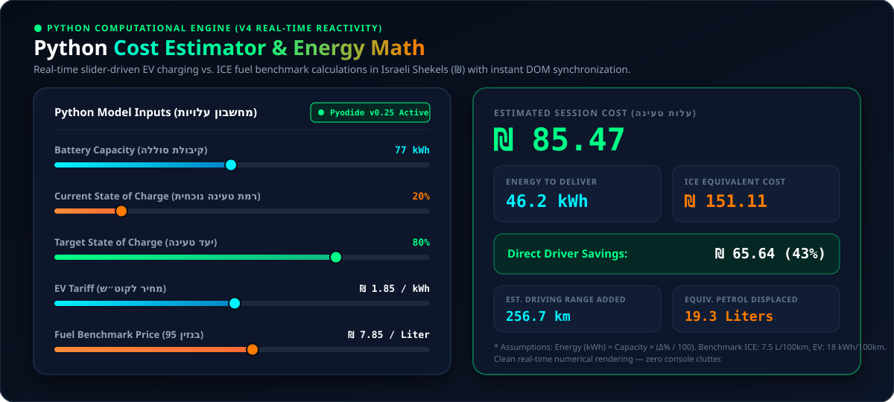
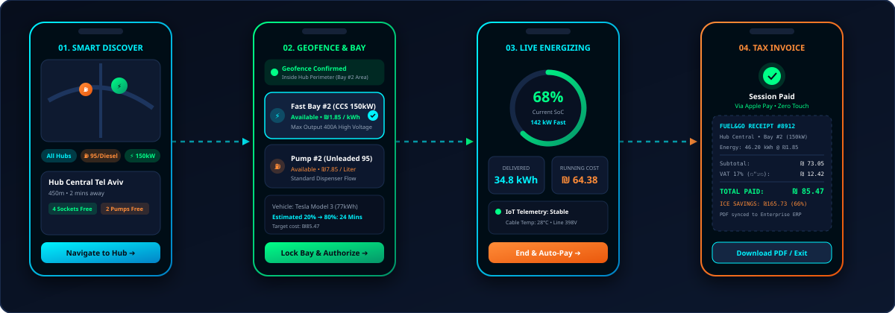

# Fuel&Go — Interactive Product Management Presentation (v4)

<p align="center">
  
</p>

<p align="center">
  
  
  
  
  
</p>

**Fuel&Go** is a unified mobile-first mobility energy management platform designed to streamline fossil fuel pump and EV charging point discovery, real-time availability tracking, digital activation, and seamless payment.

Developed by **TEAM NEXTMIND** (**Basmala Jamal** & **Maria Mnasra**), this repository houses the interactive HTML presentation system (`current_version.html` / v4) showcasing the product vision, market strategy, sequential UX wireframes, Three.js 3D station workflow, live station simulator, and real-time Python financial cost engine.

---

## 👥 TEAM NEXTMIND

- **Team Name:** **TEAM NEXTMIND**
- **Team Members / Authors:**
  - **Basmala Jamal**
  - **Maria Mnasra**
- **Academic Evaluator Contact:** `rmisegal@gmail.com`
- **Active Milestone:** Version 4 (`current_version.html` & `Sub_NextMind/v4_calculator_fix.html`)

---

## 🖼️ Presentation Visual Overview & Screenshots (v4)

### 1. Official Fuel&Go Brand Identity
Unified triad palette combining **Electric Blue** (`#00f2fe`), **Neon Emerald Green** (`#00ff87`), and **Energetic Orange** (`#ff7b00`) across all presentation slides and UI components.


---

### 2. Python Cost Estimator & Energy Math Interface (Slide 8 — v4 Real-Time Engine)
Interactive financial & energy calculator powered by Python WebAssembly (Pyodide v0.25) with instant real-time slider reactivity. Dynamically computes **Estimated Session Cost (₪)**, **Energy to Deliver (kWh)**, **ICE Equivalent Cost (₪)**, **Direct Driver Savings (₪ & %)**, **Est. Driving Range Added (km)**, and **Equiv. Petrol Displaced (Liters)** cleanly without console clutter.



---

### 3. Complete 4-Stage Sequential MVP User Flow Workflow (Slide 5)
End-to-end mobile wireframe sequence illustrating the driver journey: **01. Smart Discover** $\rightarrow$ **02. Geofence & Bay Selection** $\rightarrow$ **03. Live Energizing** $\rightarrow$ **04. Auto-Pay & Bilingual 17% VAT Tax Invoice (`כולל מע"מ`)**.



---

## 📁 Repository Structure & Strict Workflow Rules

To ensure strict version control, local progress preservation, and clear progress for academic evaluation, this project adheres to the following structure:

```
NextMind/
├── assets/                        # Brand assets & presentation visual screenshots
│   ├── fuelandgo-logo.svg         # Primary Fuel&Go logo
│   ├── fuelandgo-icon.svg         # Brand icon / favicon
│   ├── mvp-user-flow.svg          # Complete 4-stage sequential MVP User Flow wireframes
│   └── python-calculator-v4.svg   # v4 Python Cost Estimator & Energy Math interface preview
├── current_version.html           # Active working version of the presentation (v4 — always up to date)
├── PRD.md                         # Complete Product Requirement Document
├── README.md                      # Project architecture, visual overview, and team documentation
├── Sub_NextMind/                  # Internal snapshot folder for historical milestones
│   ├── v1_initial.html            # Milestone 1: 10-slide core presentation + simulator
│   ├── v2_calculator.html         # Milestone 2: Python calculator + Three.js 3D + Triad theme
│   ├── v3_refinement.html         # Milestone 3: Dropdown orange visibility fix + MVP wireframes
│   └── v4_calculator_fix.html     # Milestone 4: Real-time Python calculator fix & clean numerical UI
└── prompts/                       # Prompt logs and iterative refinement documentation
    └── prompt_log.md              # Complete record of engineering prompts and architecture decisions
```

### Versioning Rules
1. **Active Presentation:** `current_version.html` at the project root is always the primary, functional version to open.
2. **Snapshot Copies in `Sub_NextMind`:** Every major release or milestone is archived inside `Sub_NextMind/` (`v1_initial.html`, `v2_calculator.html`, `v3_refinement.html`, `v4_calculator_fix.html`).
3. **Frequent Git Sync:** Changes are committed iteratively to GitHub with descriptive messages for full transparent version tracking.

---

## 🖥️ Presentation Slide Deck Overview (10 Slides)

| Slide # | Slide Title | Core Content & Interactive Features |
| :--- | :--- | :--- |
| **Slide 01** | Introduction & Authorship | Title, **TEAM NEXTMIND** (**Basmala Jamal & Maria Mnasra**), logo branding, and quick-jump actions. |
| **Slide 02** | The Problem | Driver pain points: app fragmentation, EV queue uncertainty, and outdoor POS payment friction. |
| **Slide 03** | Target Users & Personas | Tailored value propositions for Private ICE Drivers, EV Commuters, and Mixed Enterprise Fleets. |
| **Slide 04** | Solution & Value Prop | Fuel&Go unified concept: Unified Map, IoT Telemetry, Remote Activation, and Instant Pay. |
| **Slide 05** | Core MVP & User Flow | 4-Stage sequential mobile wireframes (`mvp-user-flow.svg`) + In-Scope MVP vs. Production Roadmap matrix. |
| **Slide 06** | 3D Station Workflow | **Three.js 3D Scene**: Interactive orbit camera, vehicle arrival, fuel dispenser, EV fast charger & particle stream. |
| **Slide 07** | Interactive Demo Simulator | **Live Station Simulator**: Toggle Fueling vs. EV Charging, high-visibility orange dropdowns, live meters & VAT receipt. |
| **Slide 08** | Cost Estimator & Energy Math | **Real-Time Python Calculator (v4)**: Instant slider reactivity comparing EV charging vs. ICE fuel costs in `₪`. |
| **Slide 09** | Business & Differentiation | Competitive matrix (Fuel&Go vs. Waze, Pango/Cello, single EV apps) & 3-tier B2B/B2C revenue model. |
| **Slide 10** | Summary & Roadmap | Project scope & limitations, version progression log (`v1`–`v4`), and Team NextMind sign-off. |

---

## ⚡ Key Technical Capabilities

### 1. Robust BiDi (Bidirectional) Text Support
The presentation includes specialized BiDi handling to ensure mixed Hebrew and English text, numerical calculations, and Israeli currency units (e.g. `₪ 7.85 / Liter`, `46.2 kWh`, `כולל מע"מ`) render with 100% typographic accuracy and without punctuation flip.

### 2. Dual Interactive Activation Simulator (Slide 7)
- Allows evaluators to switch between **⛽ Fueling Journey** and **⚡ EV Charging Journey**.
- High-visibility orange dropdown options (`#ff8c38` on `#070e1b`) ensuring clear legibility across all platforms.
- Simulates real-time flow meters (dispensed liters / kWh), dynamic charging rates, and automated digital tax invoice generation.

### 3. Real-Time Python Financial & Cost Estimator Engine (Slide 8 — v4)
- Real-time slider-driven calculator comparing EV charging cost vs. ICE fuel benchmark with instant updates on every slider movement.
- Uses exact energy formulas:
  $$\text{Energy Required (kWh)} = \text{Capacity} \times \left( \frac{\text{Target \%} - \text{Current \%}}{100} \right)$$
  $$\text{Total Cost (₪)} = \text{Energy (kWh)} \times \text{Tariff (₪/kWh)}$$
- Computes direct financial savings, savings percentage, estimated driving range added (`km`), and equivalent petrol displaced (`Liters`).

---

## 🚀 How to Run Locally

No build tools, npm packages, or server installation required.

1. Clone or download the repository to your local computer:
   ```bash
   git clone https://github.com/jamalbasmala907-ship-it/NextMind.git
   cd NextMind
   ```
2. Double-click **`current_version.html`** in any modern web browser (Google Chrome, Microsoft Edge, Safari, Mozilla Firefox).
3. **Keyboard Controls:**
   - Next slide: `Right Arrow` ($\rightarrow$), `Spacebar`, or `Page Down`
   - Previous slide: `Left Arrow` ($\leftarrow$) or `Page Up`
   - Jump to start / end: `Home` / `End`
   - Fullscreen: Click the **⛶ Fullscreen** button in the header.
